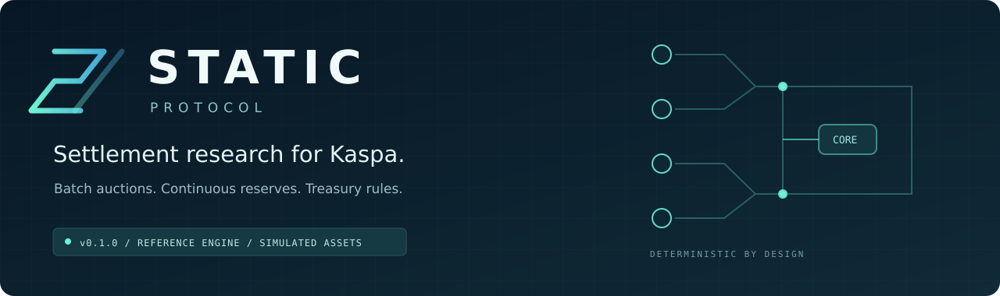

<p align="center">
  
</p>

<p align="center">
  <a href="https://github.com/GEEKProtocol0110/static-protocol/actions/workflows/test.yml"></a>
  
  
  
</p>

<p align="center">
  <a href="docs/STATIC-Whitepaper-v1.0.pdf">Whitepaper</a> ·
  <a href="docs/ARCHITECTURE.md">Architecture</a> ·
  <a href="docs/STATUS.md">Roadmap &amp; status</a> ·
  <a href="CONTRIBUTING.md">Contributing</a>
</p>

# STATIC Protocol

**An executable foundation for batch settlement, continuous reserves, and treasury research on Kaspa.**

STATIC models the order-intake, batch-settlement, reserve, and treasury ideas in
the supplied *STATIC Protocol Technical Whitepaper v1.0*. This first build makes
the accounting executable and testable. It does not accept funds, issue tokens,
create wallets, or broadcast Kaspa transactions.

| Today | Next milestone |
| --- | --- |
| Local reference engine with 48 passing tests, persistent accounting, and a JSON operator API | A compiled intake covenant validated against a pinned Kaspa toolchain |

The project is in the **reference implementation** stage. The economic models
and protocol integration gates are documented so contributors can distinguish
working behavior from proposed on-chain features.

## Start here

Requires Python 3.11 or later. No third-party runtime packages are needed.

```bash
git clone https://github.com/GEEKProtocol0110/static-protocol.git
cd static-protocol
python -m static_protocol demo
python -m unittest discover -s tests -v
```

Start the optional local operator API:

```bash
python -m static_protocol serve
```

The demo creates an isolated temporary ledger, funds two simulated accounts,
places orders, settles a batch, checks accounting, and exercises independent
curve, AMM, and treasury models. It prints a JSON receipt and result. Every demo
run starts clean; its temporary database is removed afterward.

The API listens on `127.0.0.1:8787`. It prints an operator token at startup. The
default database `static-sim.sqlite` persists between server restarts. You can
provide a stable token through `STATIC_SIM_TOKEN` (at least 32 characters).
Treat this token as local administrative access to every simulated account.
The API has no public-user authentication and must stay on loopback.

For a complete automated HTTP example, leave the server running and use:

```bash
python examples/http_demo.py
```

The example prompts for the token instead of storing it. Use a new database
for a clean walkthrough: `python -m static_protocol serve --db walkthrough.sqlite`.

## What works

| Component | Implemented behavior |
| --- | --- |
| Intake | Immutable order intent fields; owner/nonce uniqueness; collateral reservation; cancellation; DAA expiry |
| Radiator model | Up to 80 modeled intake orders per sweep; rotating admission; atomic SQLite settlement |
| Auction | Uniform clearing price; maximum executable volume; deterministic ties; partial fills; limit protection |
| Fees | Foreign 0.050% and native 0.025% schedules; integer rounding; fees accrued as USD_TEST |
| Ledger | Available and locked balances; simulated funding/withdrawals; per-asset conservation checks |
| Receipts | Durable batch records; idempotent sweep requests; linked SHA-256 hashes; integrity checks |
| Reserve model | Chosen linear curve; integral pricing; two-way redemption; slippage bounds; per-transaction issuance cap |
| AMM model | Independent constant-product swaps with integer rounding and minimum-output bounds |
| Treasury model | Simulated-sompi 50/25/25 allocation and linear OpEx release capped at 5% per 30-day epoch |
| API | Local token-protected JSON endpoints; real HTTP end-to-end tests |

The curve, AMM, and treasury are **independent in-memory economic models**. They
are not connected to the persistent order ledger or exposed as API operations.
The demo exercises their arithmetic separately. Exchange USD_TEST fees are not
silently relabeled as KAS or routed to the treasury.

<details>
<summary><strong>Units, fee rounding, and simulation assumptions</strong></summary>

- `STATIC_TEST` is a fictional base asset, counted in indivisible lots.
- `USD_TEST` is a fictional quote asset, counted in integer atoms. One price
  tick means one quote atom per base lot. No USD peg is claimed.
- All monetary wire values are integers, bounded to signed 64-bit storage.
- Both sides pay the chosen fee schedule. Maker/taker classification is not
  implemented; the whitepaper does not specify it for a batch auction.
- Fees round upward per order per batch. Very small trades can pay the same
  rounded fee on both rails; 50% is the rate discount, not an exact dust rebate.
- Buy reservations use per-lot rounded fee coverage so repeated partial fills
  cannot exhaust collateral. Excess collateral is refunded during settlement.
- Native fee eligibility is an operator-selected simulation input. There is no
  wallet/vault proof or real gas subsidy.
- DAA is a monotonic simulation counter supplied to a sweep, not wall-clock
  time or a trusted node reading. Expiry is processed when a sweep advances it.
- One owner may have open orders on one side at a time. This prevents same-name
  self-trading but cannot prevent a person using multiple simulated names.

</details>

## Repository map

```text
static_protocol/    Auction, ledger, API, and economic reference models
tests/             Deterministic, adversarial, concurrency, and HTTP checks
examples/          Worked settlement output and local API walkthrough
docs/              Whitepaper, architecture, decisions, status, and validation
.github/           CI workflow, issue forms, and pull request template
```

## Contribute

Start with [CONTRIBUTING.md](CONTRIBUTING.md). Reproducible accounting bugs,
auction edge cases, and narrow covenant integration proposals are useful first
contributions. Changes to economic rules should explain the intended invariant,
the proposed behavior, and the evidence used to validate it.

See [CHANGELOG.md](CHANGELOG.md) for the initial implementation and
[SECURITY.md](SECURITY.md) for the current trust boundary.

## Read before chain integration

- [Architecture and accounting](docs/ARCHITECTURE.md)
- [Whitepaper gaps and implementation decisions](docs/SPEC_REVIEW.md)
- [API contract](docs/API.md)
- [Current status and next implementation gates](docs/STATUS.md)
- [Threat model](SECURITY.md)
- [Pinned source observations](docs/SOURCES.md)
- [Original supplied whitepaper](docs/STATIC-Whitepaper-v1.0.pdf)

No mainnet deployment, external performance benchmark, non-custodial security,
MEV immunity, bridge finality, or stablecoin guarantee has been demonstrated by
this build. The next engineering milestone is a compiled, locally tested intake
covenant and transaction adapter against a pinned Kaspa toolchain.
